# The 10-year at 5%: it is the Fed path, not the term premium

**US rates | Study 4 research note | 20 November 2026 | Data to 13 November 2026 (pulled 19 November 2026)**

**One-line answer:** Under our primary model (ACM), the 2026 rise in the 10-year yield is almost entirely a higher expected path for policy rates. The term premium contributed close to nothing, and nothing about the 2026 mix passed a pre-registered test of being unusual.

---

## Key takeaways

- **The rise is path-driven.** From 31 Dec 2025 to 13 Nov 2026 the ACM 10-year zero yield rose **+87bp**. Of that, **+89bp** was the risk-neutral (expected-path) component and **-2bp** the term premium. Kim-Wright splits it **+48bp path / +42bp term premium**. Both models put the term-premium share below one half (ACM -0.03, KW 0.47), so the pre-registered verdict is **"path driven"**.
- **It is real yields, not inflation compensation.** The 10-year par yield rose **+97bp**. The real yield (DFII10) rose **+98bp** and the breakeven (T10YIE) moved **-1bp**. At 2.91% the 10-year TIPS yield is near its 5 Oct peak of 2.95%, the highest since November 2008.
- **The long end has not decoupled from policy.** The R² of daily 10-year changes on 2-year changes is **0.67** in 2026, ranked **21st of 36** years (1990-2025) from the bottom. The 10-year moved about **0.73bp per bp** of the 2-year.
- **The term premium is not stretched.** ACM's 10-year term premium sits at the **44th percentile** of its 1990-2026 history; Kim-Wright's sits at the **62nd**.
- **No tested hypothesis survived.** None of the four pre-registered tests (decoupling, two oil channels, the FOMC-day response) survives Benjamini-Hochberg at q = 0.10. The two results that look positive under Kim-Wright rest on a model whose daily term premium is, to an R² of 0.99, half the yield change.

---

## The debate

The 10-year Treasury yield closed at **5.15%** on 13 Nov 2026, after peaking at 5.31% on 5 Oct, its highest since May 2002 (E8). The Fed raised the target range by 25bp on 16 Sep 2026, its first increase since 2023, and held at 3.75-4.00% on 28 Oct. The next decision is on 9 Dec.

There are two readings of a 5% 10-year.

1. **The Fed story.** Investors expect policy rates to be higher for longer, and the long end is simply averaging those expected rates over ten years.
2. **The term-premium story.** Investors demand more compensation for holding duration because of oil and inflation risk, deficits, and Treasury supply. The long end is high for reasons that have little to do with the policy path.

The stories imply different exposures. If the path dominates, the 10-year keeps trading off the 2-year and Fed communication is the main risk. If the term premium dominates, the long end can sell off even on a dovish Fed, and oil or supply shocks matter more than the dot plot. This note asks which description the data support.

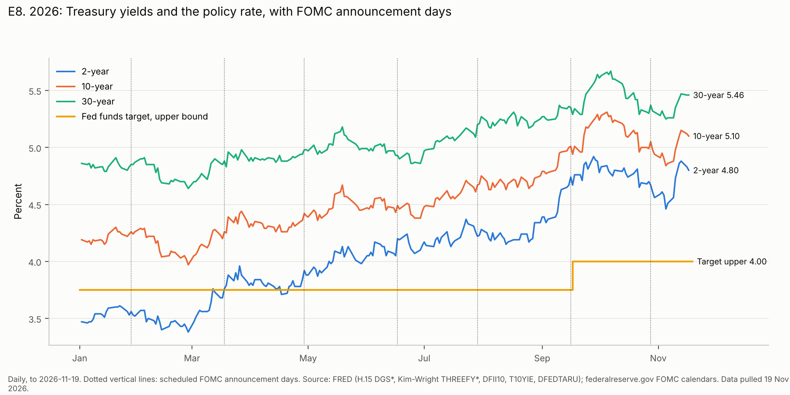

*E8. The 2-year rose +141bp in 2026 to 13 Nov, against +97bp for the 10-year. The 2s10s slope flattened from 71bp to 27bp. Source: FRED.*

---

## Method in plain words

**Two models split the yield.** A 10-year zero-coupon yield is the average short rate investors expect over ten years (the "risk-neutral" yield) plus a term premium. Neither piece is observed, so each must be estimated.

- **ACM (primary model).** The New York Fed's Adrian-Crump-Moench model, fitted on the zero curve, with daily estimates from 1990.
- **Kim-Wright (secondary model).** The Federal Reserve Board's model, published on FRED as THREEFY10 and THREEFYTP10.

A result that holds under only one model is labelled "model-dependent".

**A model-free cross-check.** The 10-year par yield equals the 10-year TIPS real yield plus the 10-year breakeven. This split is different from the term-premium split (real versus inflation compensation, not path versus premium). It is reported beside the main split and never substituted for it.

**Pre-registration.** Questions, windows, thresholds and kill rules were frozen in commit `596af1d` before any 2026 decomposition was computed; two definitions were added in `649d424`, also before any result.

**False-discovery control.** Four claims were tested with p-values, and Benjamini-Hochberg at q = 0.10 was applied once across those four. H1 is a decision rule rather than a test. H2 and H5b have fewer than eight observations, so under the programme's small-sample rule they are reported as **priors only** and not tested. Every test is logged in `out/tests_run.csv`.

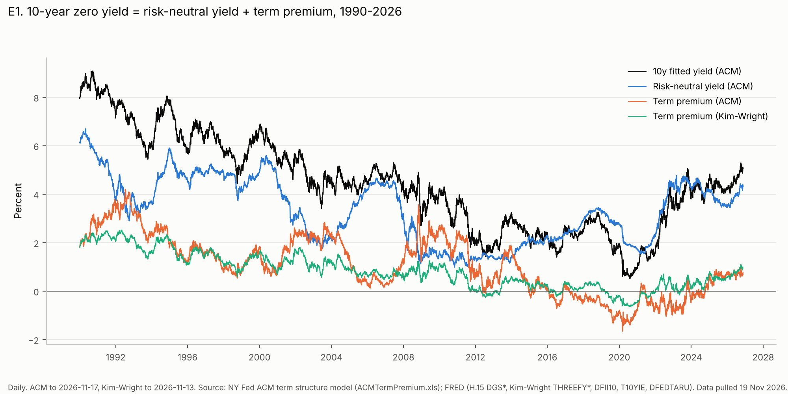

*E1. ACM 10-year zero yield, risk-neutral yield and term premium, with the Kim-Wright term premium overlaid, 1990-2026.*

---

## Findings

### H1. What drove 2026? The expected path (decision rule: "path driven")

The claim tested was that the term premium accounts for more than half of the 2026 change. **The claim is killed.**

| 31 Dec 2025 to 13 Nov 2026 | Change in 10y zero | Risk-neutral | Term premium | Term-premium share |
|---|---|---|---|---|
| ACM | +86.6bp | +89.0bp | -2.4bp | **-0.03** |
| Kim-Wright | +89.3bp | +47.8bp | +41.5bp | **0.47** |

Both shares are below 0.5, so the pre-registered rule returns "path driven". The margins are very different, though: ACM is 0.53 below the threshold and Kim-Wright is 0.03 below. Extending the ACM window to 17 Nov leaves the share at -0.001 (robustness check R4).

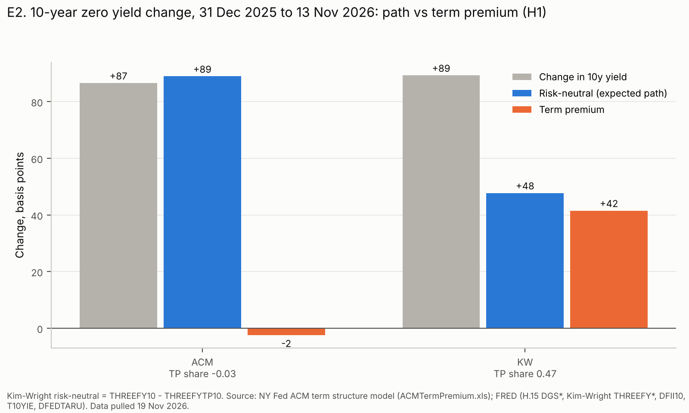

*E2. Change in the 10-year zero yield split into expected path and term premium, ACM and Kim-Wright (H1).*

The model-free split points the same way (R5). The 10-year par yield rose **+97bp**: the real yield rose **+98bp** and the breakeven moved **-1bp**. Inflation compensation did not drive the move. In this data T10YIE is defined as DGS10 minus DFII10, so the split has no residual by construction.

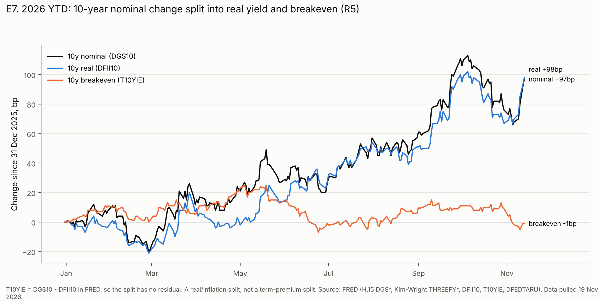

*E7. Cumulative 2026 change in the 10-year nominal yield, real yield and breakeven (R5).*

### H2. Is the 2026 mix unusual against past hiking cycles? (PRIOR ONLY, N = 6 < 8)

The prior was that the term-premium share in the 2026 first-hike window (126 trading days before the 16 Sep hike to 40 days after) is higher than in each of the six earlier cycles. With six episodes this cannot be tested, only described.

The description runs **against** the prior. The 2026 window's term-premium share is **0.10** under ACM (+80.5bp yield, +72.7bp path, +7.8bp term premium) and **0.46** under Kim-Wright. That is lower than every prior cycle with a reportable share under both models. Under ACM those shares are 0.26 (1994), 0.67 (1999), 1.03 (2015) and 0.18 (2022); under Kim-Wright they are 0.47, 0.48, 0.60 and 0.49. 1997 and 2004 had yield changes under 25bp, so no share is reported (full table in `RESULTS.md`).

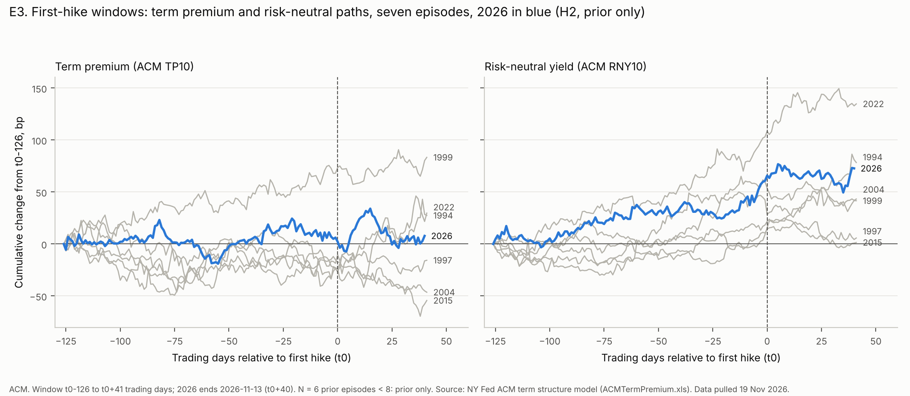

*E3. Cumulative term premium (left) and risk-neutral yield (right) around seven first hikes, ACM. 2026 in blue (H2, prior only).*

### H3. Has the long end decoupled from policy? No (killed)

If a term-premium shock were driving the long end, daily 10-year moves should be less explained by daily 2-year moves. **They are not.** The 2026 R² is **0.668** with a slope of **0.73**, ranked 21st of 36 base years from the bottom. The rank p-value is 0.595, the BH-adjusted p is 0.791, and the 10th-percentile threshold was 0.43. The 30-year version (robustness check R2) gives the same answer: R² 0.39, p 0.459. The low-R² years were 2011-2013 and 2021, not 2026.

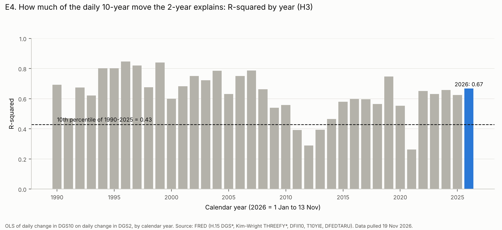

*E4. R² of daily changes in the 10-year on the 2-year by calendar year, with the 1990-2025 10th percentile marked (H3).*

### H4. Is oil moving the term premium? Not under the primary model (H4a and H4b killed)

**H4a** asked whether the ACM term premium has a positive weekly slope on oil in 2026. The slope is positive (16.4bp per unit change in log WTI) but weak: **t 1.47**, one-sided p 0.071, BH p 0.285 over 46 weeks. **Killed.**

**H4b** asked whether oil sensitivity is larger in 2026 than in 1990-2025. The interaction term is **negative** (-12.3, t -0.81), with BH p 0.791. **Killed.** Excluding March-April 2020 (robustness check R3) changes neither result.

Under Kim-Wright the 2026 slope has t 3.22 (robustness check R1), so H4a is formally model-dependent. The exploratory check X1 below explains why that result carries little weight. The rolling 52-week oil beta of the ACM term premium stood at about 16bp at 13 Nov, well below its 2024 levels (E5).

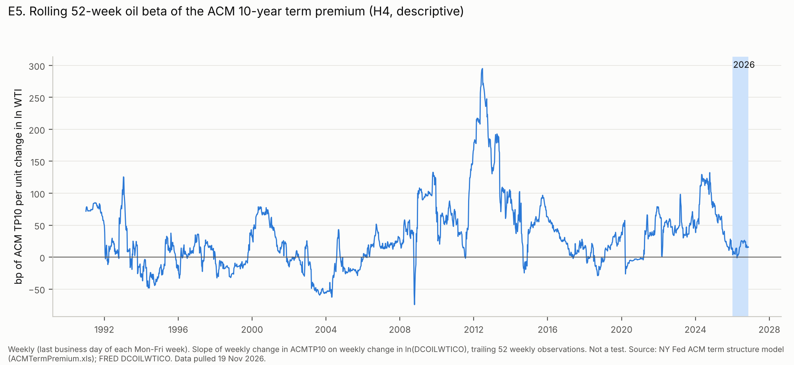

*E5. Rolling 52-week oil beta of the ACM 10-year term premium, 2026 shaded (descriptive, not a test).*

### H5. How does the term premium react on Fed days? It does not, on average (H5a killed; H5b prior only)

**H5a.** On 255 scheduled FOMC announcement days from 1994 to 2025, the slope of the ACM term premium's change on the 2-year's change is **0.04** (t 0.48, BH p 0.791): positive, but indistinguishable from zero. **Killed.** On a typical Fed day the 10-year reacts through the expected path, not the term premium. Under Kim-Wright the slope is 0.33 with t 12.9 (R1), which is model-dependent and discounted for the same reason as H4a.

**H5b (PRIOR ONLY, N = 7 < 8).** Across the seven 2026 announcement days, the term premium's share of the absolute daily move averages **0.49**, against **0.53** for 1994-2025; three of the seven days are above that average. The largest term-premium moves came on 29 Jul (+12.4bp against a -5.4bp path move) and 28 Oct (+8.5bp against -2.0bp), both days on which the 2-year fell and the 10-year rose. The hike day itself, 16 Sep, saw the path component rise 5.0bp and the term premium fall 3.9bp.

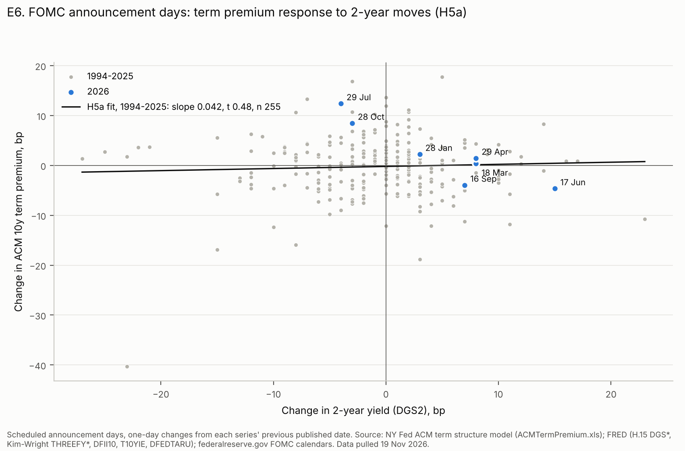

*E6. Change in the ACM 10-year term premium against the 2-year change on announcement days. Grey = 1994-2025, blue = 2026 (labelled), line = H5a fit.*

---

## Model disagreement is itself a finding

- **The 2026 split.** For nearly the same yield change (+87bp versus +89bp), the models differ by **44bp** on the term premium and **41bp** on the expected path.
- **Levels.** ACM's term premium was 18bp above Kim-Wright's at the end of 2025 and **26bp below** it on 13 Nov. Since 1990 the gap has ranged from -128bp (April 2022) to +236bp (November 2008), with a mean absolute gap of 57bp (E9).
- **Percentiles.** The current level ranks at the 44th percentile under ACM and the 62nd under Kim-Wright (E10).

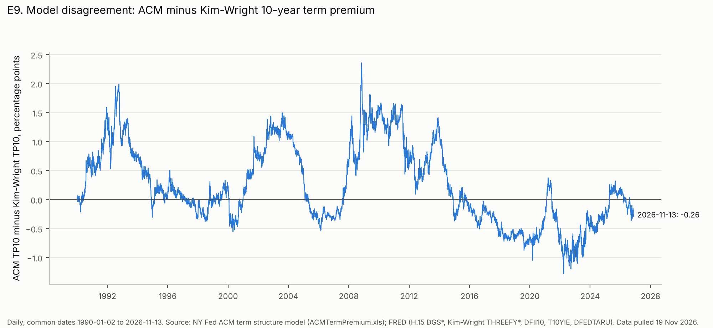

*E9. ACM minus Kim-Wright 10-year term premium.*

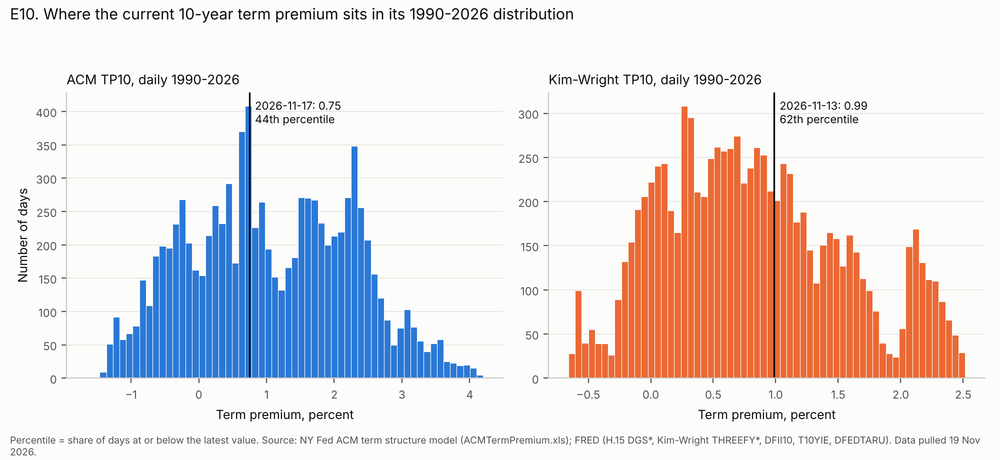

*E10. Current 10-year term premium against its 1990-2026 daily distribution, ACM and Kim-Wright.*

**X1 (exploratory, not in the BH family): why Kim-Wright's high-frequency results carry little weight.** Regressing each model's daily term-premium change on its own daily 10-year yield change gives:

| | 1990-2026 | 2026 only |
|---|---|---|
| Kim-Wright: β, R² | 0.50, **0.96** | 0.50, **0.99** |
| ACM: β, R² | 0.69, 0.61 | 0.58, 0.54 |

At daily frequency, Kim-Wright's term premium is almost exactly half of whatever the yield did. Any regression of the Kim-Wright term premium on a yield-moving variable (oil, the 2-year on Fed days) will therefore find a strong positive slope, largely by construction. That is why the Kim-Wright-only results (the t of 3.22 in R1-H4a and of 12.9 in R1-H5a) carry little evidential weight. ACM's term premium also co-moves with yields, but roughly 40-45% of its daily variance is independent of them.

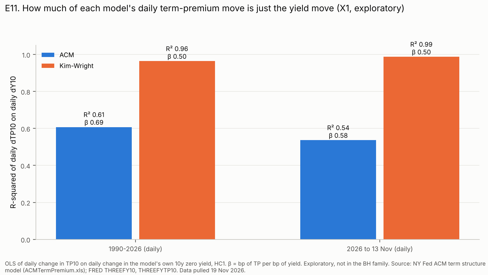

*E11. R² and slope of each model's daily term-premium change on its own yield change (X1, exploratory).*

---

## What it means for 9 December

The evidence points to a long end that trades off the policy path.

- **The 10-year follows the 2-year at about 0.73bp per bp.** That is the 2026 slope, with an R² of 0.67, so the 2-year's reaction is the main transmission channel.
- **The ACM term premium has not reacted systematically on Fed days** (H5a).

The practical reading is that **guidance on the path matters more than the hike itself**. An expected 25bp move should do little on its own; what moves the 10-year is any change in the expected path implied by the statement, projections and press conference. A 10bp repricing of the 2-year would map to roughly 7bp on the 10-year on the 2026 relationship. That relationship is an average, not a forecast for one day: the 2026 Fed days show a wide spread around it (E6).

The study will record the 9 Dec reaction as live check P1 once ACM publishes that date. It is one observation and supports no inference.

---

## What would change the view

The conditions below are monitoring triggers set in this note. They are not pre-registered tests. Each should be read on or before **31 Mar 2027** unless stated otherwise.

1. **Breakevens take over.** T10YIE closes at or above **2.49%**, 25bp above its 13 Nov level of 2.24%, while DGS10 is rising. That would make inflation compensation, not real rates, the marginal driver.
2. **The term premium becomes stretched.** ACM TP10 rises above **2.23%** (its 1990-2026 80th percentile) or Kim-Wright TP10 above **1.48%** (its 80th percentile). On 13 Nov they stood at 0.72% and 0.99%.
3. **The long end decouples.** The R² of daily DGS10 changes on DGS2 changes, measured from 1 Jan 2027, falls below **0.43**, the 1990-2025 10th percentile. A quarter's worth of days is a small sample, so this is a warning sign rather than a verdict.
4. **P1 is term-premium-led.** On 9 Dec, the ACM term premium accounts for more than half of the absolute daily move (D1 share above 0.5), with the same sign as the 10-year change.

Any one weakens the path-driven reading; 1 and 2 together would overturn it.

---

## Caveats

- **Model estimates get revised.** ACM and Kim-Wright are re-estimated as new data arrive, so past values can change. The numbers here are the vintage pulled on 19 Nov 2026.
- **The models disagree, and neither is ground truth.** Neither model separates fiscal or supply premia from inflation-risk premia. The oil test covers one channel, not all of them.
- **Small hike-window sample.** Six prior first-hike episodes start from very different conditions, such as the 1994 bond rout and 2022's start from zero rates. H2 is a prior, not a result.
- **Par versus zero (X2, exploratory).** The headline +97bp is the par yield; H1 uses the ACM zero yield (+86.6bp). The 10.4bp gap is not a data or date problem: both series exist on both end dates, and 2026 daily changes correlate 0.96 same-day versus about -0.07 at a one-day lead or lag. Rebuilding the par yield from ACM's 1-10 year zero curve splits the gap into **6.1bp of curve shape** (the zero-par difference narrowed as 2s10s flattened from 71bp to 27bp) and **4.3bp of residual** (CMT par yield against the fitted curve). That assumes continuous compounding; under annual compounding the split is 1.9bp and 8.5bp. Kim-Wright's zero rose +89.3bp. The H1 verdict is unaffected, because both of its components sit on the same zero curve.

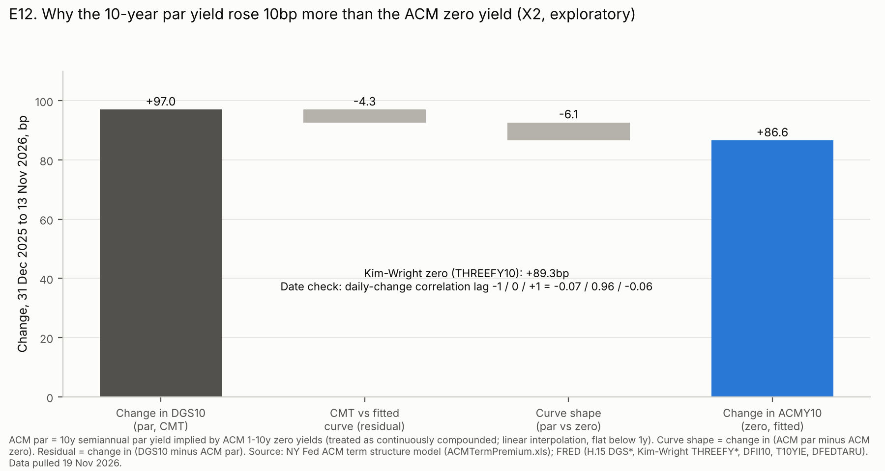

*E12. Bridge from the +97bp par-yield change to the +86.6bp ACM zero-yield change (X2, exploratory).*

---

## Sources

- **NY Fed ACM term structure model.** `ACMTermPremium.xls`, sheet "ACM Daily": ACMY01-10, ACMTP01-10, ACMRNY01-10, 1990-01-02 to 2026-11-17.
- **FRED.** Kim-Wright THREEFY2, THREEFY10, THREEFYTP2, THREEFYTP5, THREEFYTP10; H.15 DGS3MO, DGS2, DGS5, DGS10, DGS30; DFII5, DFII10, T10YIE, T5YIFR; DCOILWTICO; DFEDTARU, DFEDTARL, DFEDTAR, DFF.
- **Federal Reserve FOMC calendars.** fomccalendars.htm and fomchistoricalYYYY.htm, 1990-2026.
- **Pull date.** All data were pulled on 19 Nov 2026 (UTC). Checksums are in `data/MANIFEST.md`.
- **Traceability.** Every number traces to `out/*.csv`, `out/exhibits/*.csv`, or `data/raw/` via `src/load.py`. Test ledger: `out/tests_run.csv`; kill log: `out/killed_hypotheses.md`.

*Nothing here is a trading recommendation.*
