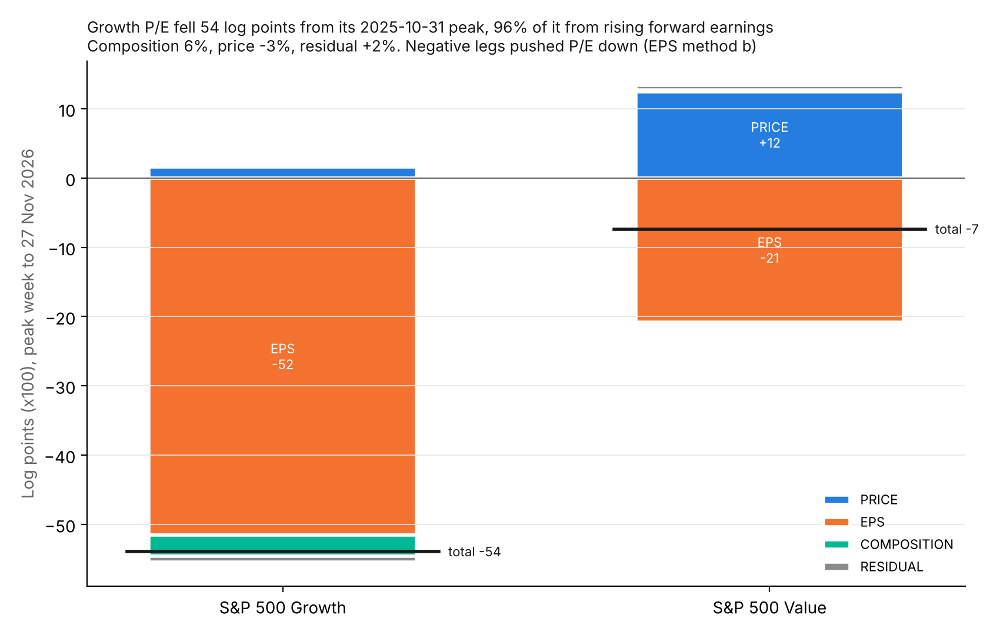

# Results: Is the Growth discount real?

Pre-registration: [`PREREG.md`](PREREG.md), dated 28 Nov 2026, committed in **d9238e3** before any computation. Run 2026-11-28, seed 7. Nothing here is a trading recommendation.

## Pre-registration table

Decision cells were filled 2026-11-28, after each test ran. The rule text is unchanged from the freeze.

| ID | Rule | Decision | Date |
|---|---|---|---|
| P1 | EPS > 60%: earnings-driven; PRICE > 50%: price-driven; else mixed | **earnings-driven** (EPS **95.5%**, PRICE -2.9%); no flip in 4 variants | 2026-11-28 |
| E | COMPOSITION > 30%: artefact material | **Not material** (COMPOSITION **5.7%**; 5.1% to 10.1% across variants) | 2026-11-28 |
| A / B | Phase 2A rule | **B supported** (FCF-minus-SBC / NI **-21.1pp**, capex / depreciation **2.98**) | 2026-11-28 |
| C / D | Phase 2B rule | **Not run**: not selected by Phase 1 | 2026-11-28 |

## 1. Verdict box

```
VERDICT: B HOLDS (inflated estimates over earnings catch-up) | confidence 50% (was 60%; revised 28 Nov 2026 post-results, see section 9)
Claim: the 2026 Growth P/E de-rating is earnings-driven, and the earnings are not backed by cash
Method: log identity dln(PE) = dln(Price) - dln(EPS) split into legs (Phase 1); top-15 cash conversion vs revisions (Phase 2A)
Data: Yardeni digitised fwd P/E + S&P DJI index levels (weekly, 2024-01 to 2026-11-27), SEC XBRL cash flows for the top-15 IVW names, Yahoo consensus snapshot 2026-11-28 | Trials counted: 30
```

**Decisive numbers**
- **Earnings, not price:** rising forward earnings account for **95.5%** of the Growth P/E drop from **29.32x** (31 Oct 2025) to **17.10x** (27 Nov 2026). Price was flat, contributing **-2.9%** (the index rose slightly).
- **Cash didn't follow:** among the top 15 Growth names, free cash flow after stock-based pay fell from **61.0%** to **39.9%** of net income in a year, while capex ran at **2.98x** depreciation.

**One sentence:** the Growth discount is not a price collapse but a jump in forward earnings estimates, and the biggest names' cash conversion has not kept up with those earnings.

Confidence was 60% at first writing and is **50%** after the post-results interpretation note in section 9: the Phase 2A metric cannot separate B from heavy real investment. Phase 1 is robust: no variant flips it. Phase 2A clears its thresholds under both aggregations, but its strongest rival (heavy AI investment that is real, not inflated) cannot be ruled out with these metrics. See section 9.

## 2. Question and pre-registered hypotheses

The S&P 500 Growth forward P/E fell from about 29x to 17.1x by 27 Nov 2026, below Value's 17.3x for the first time since 2008-09. Was that driven by:
- **price** (C, fundamental de-rating; D, discount-rate shock);
- **earnings** (A, earnings catch-up; B, inflated estimates);
- or **composition** (E, the Dec 2025 reconstitution or the forward-window roll)?

Phase 1 classifies the drop; only the Phase 2 branch it selects is run. Candidates, window, legs and thresholds were all frozen in `PREREG.md`.

## 3. Method in brief

- **Weekly grid:** Yardeni Growth and Value forward P/E (digitised), S&P DJI index levels on the same Fridays, and EPS = price / P/E (method b). Robustness uses Yardeni's Blue Angels EPS (method a).
- **Legs:** the log P/E change from the peak to 27 Nov 2026 is split into PRICE and EPS (outside the reconstitution window, 12 Dec 2025 to 2 Jan 2026), COMPOSITION (the P/E move in that window net of price), and RESIDUAL. Value is the control.
- **Phase 2A:** IVW-weighted top-15 Growth names; trailing-four-quarter cash ratios, latest vs a year earlier; revision breadth; 90-day FY1 consensus change.
- **Tags:** log identity decomposition | weighted cash-conversion screen. No model is estimated in the branches that ran.

## 4. Data stamp

| Item | Source | Window | As of |
|---|---|---|---|
| Forward P/E | Yardeni Fig 4, digitised (row1 weekly) | 2024-01-05 to 2026-11-27, 152 weeks | 2026-11-27 |
| Price | S&P DJI index levels 2029 (Growth), 2034 (Value) | daily, last close on or before each Friday | 2026-11-27 |
| EPS (a) | Yardeni Blue Angels, digitised | ends at the week of **2026-11-06**; spliced to (b) after | 2026-11-06 |
| Cash flows | SEC EDGAR XBRL, 15 quarters per company | latest filed quarter per company (NVDA latest is Jul 2026) | 2026-11-28 pull |
| Weights | iShares IVW holdings | 2026-11-25 | 2026-11-25 |
| Revisions | Yahoo consensus snapshot (breadth, FY1 vs 90 days ago) | one snapshot | 2026-11-28 |
| Credit | FRED ICE BofA IG OAS, BAA10Y (weekly) | to 2026-11-27 | 2026-11-27 |

- **Fixture gate passed:** data hashes, P/E end values 17.10 and 17.29, and IVW names 216 to 139. The documented values come from the pack README and were not re-verified in this session.
- **Exclusions:** none.

## 5. Headline chart



## 6. Results table

**Phase 1, primary (EPS method b), peak week 2025-10-31 to 2026-11-27**

| Leg | Growth, log points | Growth, share of drop | Value, log points | Growth minus Value, log points |
|---|---|---|---|---|
| Total log P/E change | **-53.9** (29.32x to 17.10x) | 100% | **-7.4** (18.61x to 17.29x) | **-46.6** |
| PRICE | +1.6 | **-2.9%** | +12.5 | -10.9 |
| EPS (organic) | -51.5 | **95.5%** | -20.8 | **-30.7** |
| COMPOSITION | -3.1 | **5.7%** | +0.3 | -3.3 |
| RESIDUAL | -0.9 | 1.7% | +0.7 | -1.6 |

The crossing (Growth's P/E falling 46.6 log points more than Value's):
- **66%** from faster Growth EPS growth (30.7 of 46.6);
- **23%** from Value's price outperforming (10.9);
- **7%** from the reconstitution (3.3).

In plain terms, Growth's forward EPS rose about **67%** (a 51.5 log-point rise) while its price barely moved.

**Phase 2A, top 15 Growth names, IVW-weighted (weighted mean of company ratios)**

| Metric | Year earlier | Latest | Change | Names | Ratio of weighted sums (robustness) |
|---|---|---|---|---|---|
| (OCF - capex - SBC) / net income | **61.0%** | **39.9%** | **-21.1pp** | 12 | 57.9% to 34.6% (-23.3pp) |
| Capex / depreciation | 2.37 | **2.98** | +0.61 | 13 | 2.60 to 3.45 |
| Capex / OCF | 36.7% | 47.1% | +10.4pp | 13 | 41.0% to 54.9% |
| OCF / net income | 1.21 | 1.14 | -0.07 | 14 | 1.13 to 0.96 |

| Revisions | Growth | Value |
|---|---|---|
| Up vs down revisions, last 30 days (count breadth) | 1,538 up vs 898 down (**+0.263**) | 2,828 vs 2,419 (+0.078) |
| FY1 consensus change over 90 days, weight-weighted | **+5.3%** (151 names) | +1.4% (428 names) |

**Rule result: B supported.** FCF-minus-SBC / NI fell 21.1pp (more than 15pp) and capex / depreciation is 2.98 (above 2.0). A is **not** supported: the cash-conversion leg fails (-21.1pp against a floor of -10pp), even though breadth is net positive. The biggest drops:

| Name | FCF-minus-SBC / NI, year earlier | Latest |
|---|---|---|
| Alphabet | 0.40 | -0.05 |
| Meta | 0.45 | 0.02 |
| Microsoft | 0.63 | 0.33 |
| Tesla | 0.86 | -0.31 |
| Amazon | -0.12 | -0.50 |

Apple, Eli Lilly and Micron improved. Per-company detail is in `outputs/phase2a_ttm_by_company.csv`.

**Credit side-check (descriptive)**, peak week to 27 Nov 2026:
- ICE BofA IG OAS: **0.80 to 0.99** (+0.19pp).
- BAA10Y: **1.69 to 1.61** (-0.08pp).
- **There is no tech-specific spread in the data pack**, so whether AI-heavy issuers' credit widened cannot be checked here.

## 7. Robustness

| Variant | Growth PRICE | EPS | COMPOSITION | RESIDUAL | Classification | Artefact flag |
|---|---|---|---|---|---|---|
| Primary (EPS b) | -2.9% | 95.5% | 5.7% | 1.7% | earnings-driven | no |
| EPS method (a) | -2.9% | 93.5% | 5.7% | 3.6% | earnings-driven | no |
| Recon window +1 week | +2.3% | 91.1% | 10.1% | -3.5% | earnings-driven | no |
| Recon window -1 week | +0.9% | 96.1% | 5.1% | -2.2% | earnings-driven | no |
| Start at 2nd-highest local peak (2025-07-25, 28.37x) | -21.2% | 113.4% | 6.1% | 1.8% | earnings-driven | no |

**No variant flips the classification or the artefact flag.**

Phase 2A's B verdict also holds on the ratio-of-sums aggregation (-23.3pp, 3.45x). The Gaussian vs t check (tail-audit) does not apply: the branches that ran estimate no regression.

## 8. Trial ledger

- `outputs/trials.csv` has **30** rows: Phase 1 (15), Phase 2A (12), credit (2), and 1 row recording that Phase 2B was not run.
- `outputs/tests_run.csv` has the four hypothesis rows (P1, E, A, B).
- **No p-values were produced,** so the protocol's Benjamini-Hochberg family is empty. Phase 2B, which carried the only p-value family, was not selected.
- **Small-N (rule 6):** every Phase 2A metric has 12 to 14 names (at least 8), so none is prior-only.

**Killed** (`outputs/killed_hypotheses.md`):
- **E, artefact:** composition is 5.7% of the drop, under the 30% bar. The Dec 2025 reconstitution did not cause the de-rating.
- **A, earnings catch-up with cash support:** FCF-minus-SBC / NI fell 21.1pp, beyond the -10pp floor.

**Not tested:** C and D (Phase 2B), because Phase 1 did not select them. The real-yield story was not examined here and should not be read as rejected or supported.

## 9. Kill conditions and rival explanations

**Would change if**
- **The scheduled re-read in the first week of January 2027:** a rerun of Phase 1 under the new style framework, effective 21 Dec 2026, could show the Growth/Value P/E ordering not surviving the new membership. A COMPOSITION leg above 30% for the Dec 2026 window would also change this reading.
- **The next two quarterly filings** (Q4 2026 results, early 2027) bring top-15 FCF-minus-SBC / NI back within 10pp of a year earlier.

**Rival explanation for B:** this is an investment phase, not inflated estimates. Capex at about 3x depreciation lowers free cash flow mechanically while it lasts, even if the earnings behind the estimates are real. The pre-registered rule cannot separate "estimates too high" from "earnings real but reinvested". Separating them needs accruals data, or estimate accuracy over time, which this pack does not contain.

**Rival explanation for Phase 1:** the forward-EPS window roll. As the 12-month forward window moves into 2027, a strong expected growth year enters mechanically. Part of the 95.5% EPS leg may be that roll, not new optimism. The pack does not separate the roll from estimate revisions. The 90-day FY1 change (+5.3% for Growth vs +1.4% for Value) shows revisions did contribute.

### Interpretation note (28 Nov 2026, post-results)

Written after the results. It changes no verdict or rule: the pre-registered rule still returns **B supported**.

**The decisive metric cannot separate B from investment.** FCF-minus-SBC / NI mechanically falls when capex rises, so a large drop is what both B (inflated earnings) and heavy real investment would produce. Passing the rule therefore does not show that earnings are inflated.

**Operating cash still roughly backs earnings.**
- **Primary measure:** weighted OCF / NI moved from **1.21 to 1.14**, still above 1.
- **Dollar-weighted robustness measure:** this falls from 1.13 to **0.96** (0.99 excluding JPM, whose bank OCF is not meaningful). On that view operating cash only about matches profits.
- **Below 1 in the latest four quarters:** Alphabet (0.76) and Nvidia (0.70).
- **Operating cash grew at the biggest spenders,** trailing four quarters vs a year earlier: Microsoft **+33%**, Alphabet **+19%**, Meta **+24%**, Amazon **+29%**.

**Capex grew much faster.** Microsoft **+97%** and Alphabet **+105%** roughly doubled; Meta rose **+67%** and Amazon **+79%**. Across the 13 top names that report capex (excluding JPM), capex rose **78%** in aggregate (67% as a weighted mean) against operating cash up **40%**.

**Supported reading.** Earnings are cash-backed at the operating level but are being reinvested at about **3x** depreciation (2.98x weighted). The forward risk is depreciation drag as that capex reaches the income statement, and the return on AI investment. **Current accounting inflation is not shown by this evidence.**

**Data note.** Nvidia's latest quarter in the SEC feed is **July 2026** (fiscal quarter ending 2026-07-26). Its October 2026 quarter was not yet available, so its trailing figures lag the other names by one quarter.

**Why confidence is lowered from 60% to 50%.** The B verdict rests on one metric that falls under both B and its main rival. The one piece of evidence that does separate them, operating cash relative to profits, points toward the investment reading on the primary measure and is ambiguous on the robustness measure. With no accruals or estimate-accuracy data in the pack, the rule's result is closer to a coin toss than first stated.

## 10. Next step and repo path

- **January 2027:** rerun `run_all.py` against a refreshed pack after the 21 Dec reconstitution. Compare the P/E ordering and the composition leg; replace the FINDINGS section.
- **Follow-up test of the depreciation drag,** once the Q4 2026 filings and the 21 Dec 2026 reconstitution are in. It will be pre-registered before the data is loaded. It compares, for the top Growth names, the path of capex / depreciation against consensus EPS growth for 2027-28: does rising depreciation from the 2025-26 capex outrun the earnings growth the estimates assume?
- **Testing the investment-phase rival needs extra data:** a fixed-membership EPS recompute (end-2025 constituent EPS) and a tech/hyperscaler credit spread (bond-level TRACE).
- **Repo path:** `studies/11-2026-growth-value-derating/`. Rerun with:

```
python run_all.py
pytest
```

## Deviations from pre-registration

1. **Residual under method (b).** PREREG.md said the residual is zero by construction under EPS method (b). That is wrong for the leg definitions in the brief: inside the reconstitution window, the price move is excluded from both the PRICE and COMPOSITION legs, so it lands in the residual. The residual under (b) equals that window price move, -0.9 log points or 1.7% (asserted in `tests/test_study.py`). No rule or threshold was changed, and the classification does not depend on it: allocating the window price move to PRICE gives PRICE -1.2%, EPS 95.5%.
2. **EPS (a) end date.** The (a) series runs to the week of 2026-11-06, not about 30 Oct as the brief expected. The splice to (b) happens there.
3. **Scope notes, not deviations.**
   - JPM enters only the OCF / net income metric (banks report no capex), and its ratio is not economically meaningful for a bank. At 1.8% weight its effect is small; FCF-minus-SBC / NI excludes it, and Berkshire has no SBC concept.
   - The top-15 weights sum to 68.5% of IVW (Alphabet's two share classes combined).

## Known limitations (from PREREG)

- **No fixed-membership recompute:** there is no end-2025 constituent EPS.
- **The reconstitution date is inferred.**
- **P/E dates are +/- 2 days.**
- **Breadth is one snapshot.**
- **IVW weights are the fund's,** not the index's.

## Final step

Add or update this study's section in FINDINGS.md (repo root), then run
`python scripts/check_findings.py`. Re-runs replace the section; they never
add a second one.
